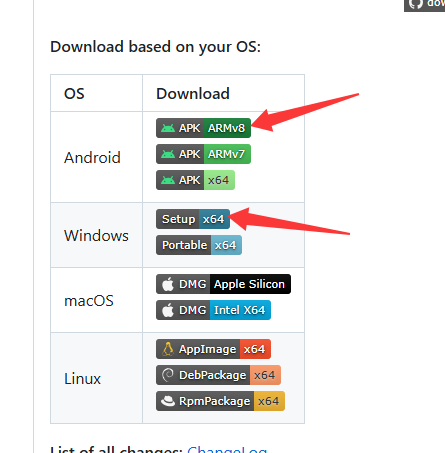

# VPN 客户端下载与安装教程

本页只介绍 **客户端的下载和安装**。安装完成后，请按照对应设备的使用教程导入公司订阅地址并开启代理。

| 使用设备 | 推荐客户端 | 跳转到下载步骤 | 安装后的使用教程 |
| --- | --- | --- | --- |
| Android 手机 / 平板 | FlClash | [Android 下载](#android) | [Android 使用教程](./mobile-android.md) |
| Windows 电脑 | FlClash | [Windows 下载](#windows) | [Windows 使用教程](./guide.md#windows-usage) |
| iPhone / iPad | Shadowrocket（小火箭） | [iOS 下载](#ios) | [iOS 使用教程](./mobile-ios.md) |

::: warning 安全提示
只使用本页列出的 **GitHub 项目发布页**或 **Apple App Store** 获取软件。不要从搜索广告、网盘或来历不明的站点下载安装包。软件下载不包含公司的订阅账号或节点配置。
:::

## 一、Android：FlClash {#android}

### 第 1 步：打开下载页面

使用 Android 手机浏览器访问 [FlClash GitHub 官方发布页](https://github.com/chen08209/FlClash/releases)，找到最新的正式发布版本。

### 第 2 步：选择 Android 安装包

在发布版本的 **Download based on your OS** 区域，找到 **Android** 一行，点击 **APK ARMv8**。绝大多数近年 Android 手机使用的都是 64 位 ARM 架构。

- **APK ARMv8**：推荐，适用于大多数 Android 手机（文件名常含 `android-arm64-v8a.apk`）。
- **APK ARMv7**：仅用于仍采用 32 位 ARM 的旧设备。
- **APK x64**：主要用于采用 x86-64 架构的特殊设备或模拟器，一般手机无需选择。

> 如果发布页面未显示系统下载表，请展开版本底部的 **Assets**，寻找对应架构的 `.apk` 文件。

### 第 3 步：安装并打开

1. 等待 `.apk` 下载完成，点击下载文件开始安装。
2. 如果系统提示不允许从此来源安装，请核对下载地址为上面的 GitHub 官方发布页后，按系统指引临时允许浏览器安装该应用。
3. 安装完毕后打开 **FlClash**。建议恢复关闭浏览器的“允许安装未知应用”权限。

**安装完成：** [进入 Android FlClash 使用教程 →](./mobile-android.md)

## 二、Windows：FlClash {#windows}

### 第 1 步：打开下载页面

在 Windows 电脑上打开 [FlClash GitHub 官方发布页](https://github.com/chen08209/FlClash/releases)，找到最新的正式发布版本。

### 第 2 步：下载 Windows 安装版

在 **Download based on your OS** 表格中找到 **Windows** 一行，普通 Windows 10 / 11 的 Intel 或 AMD 电脑请点击 **Setup x64**（截图红色箭头所示）。

| 下载选项 | 适用场景 |
| --- | --- |
| **Setup x64** | **推荐**：标准安装版，适合普通 Windows 电脑 |
| Portable x64 | 便携版，解压后运行，适合明确需要免安装的用户 |

::: tip 如何区分架构？
普通 Intel / AMD 64 位电脑选 **x64**。部分搭载高通 Snapdragon 的 Windows ARM 设备应选择发布页提供的 **ARM64** 版本（如有），不要直接使用 x64 安装包代替。
:::

如果页面中只有 **Assets** 文件列表，可选择文件名带 `windows`、`x64`、`setup` 的安装文件；不同版本的实际文件名可能变化，以官方发布页面为准。

### 第 3 步：运行安装程序

1. 下载完成后，双击安装程序（通常为 `.exe`）。
2. 按安装向导提示完成安装；如弹出 Windows 用户账户控制提示，确认发布来源后再允许安装。
3. 从开始菜单或桌面打开 **FlClash**。

**安装完成：** [进入 Windows FlClash 使用教程 →](./guide.md#windows-usage)

## 三、iPhone / iPad：Shadowrocket {#ios}

::: info iOS 与 Android、Windows 使用不同的客户端
**Shadowrocket** 是 iPhone / iPad 上使用的客户端，不能使用 FlClash 的 Android APK 或 Windows EXE 安装包。
:::

### 第 1 步：进入 Apple App Store

在 iPhone 或 iPad 上打开 **App Store**，搜索 `Shadowrocket`，或者直接使用以下官方链接：

**[打开 Shadowrocket 的 App Store 页面](https://apps.apple.com/app/id932747118)**

### 第 2 步：确认应用信息

核对应用名称为 **Shadowrocket**，开发者为 **Shadow Launch Technology Limited**，再根据 App Store 显示的信息购买或下载。

- 该应用通常为**付费应用**，具体价格和可下载地区以当前 App Store 页面为准。
- 如果提示当前地区不可下载，请联系公司技术人员确认可用的正规获取方式；**不要使用第三方 IPA、共享 Apple ID 或未知来源的安装包**。

### 第 3 步：完成安装

1. 点击 App Store 中的价格按钮或下载按钮。
2. 按系统提示使用 Face ID、Touch ID 或 Apple 账号完成购买/验证。
3. 安装成功后，从桌面打开 **Shadowrocket**。

**安装完成：** [进入 iPhone / iPad Shadowrocket 使用教程 →](./mobile-ios.md)

## 四、常见下载问题

| 问题 | 处理方式 |
| --- | --- |
| GitHub 页面无法打开或下载很慢 | 检查当前网络是否能访问 GitHub；由技术人员提供经核验的安装包，避免随意查找第三方下载站 |
| Android APK 无法安装 | 检查下载的 CPU 架构、系统版本与安装权限，优先选择 ARMv8 包 |
| Windows 不知道选哪个文件 | 普通 Intel / AMD 电脑优先选 **Setup x64**，不是 Portable，也不是 Android 的 APK |
| iPhone 找不到 Shadowrocket | 检查 App Store 搜索名称、账号地区及商店可用性，联系技术人员确认 |
| 软件安装完毕但没有节点 | 这是正常情况；客户端和公司的节点订阅是两部分，请继续阅读对应设备的 **使用教程** |

**相关文档：** [VPN 节点使用规范](./guide.md) · [Android 使用教程](./mobile-android.md) · [iOS 使用教程](./mobile-ios.md)
