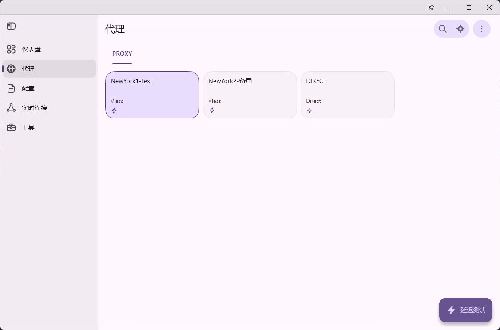
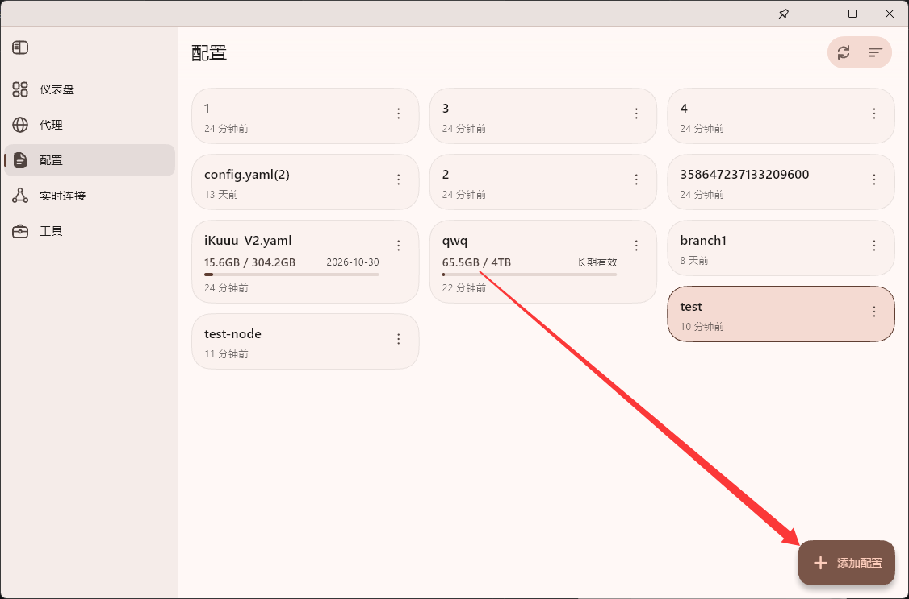
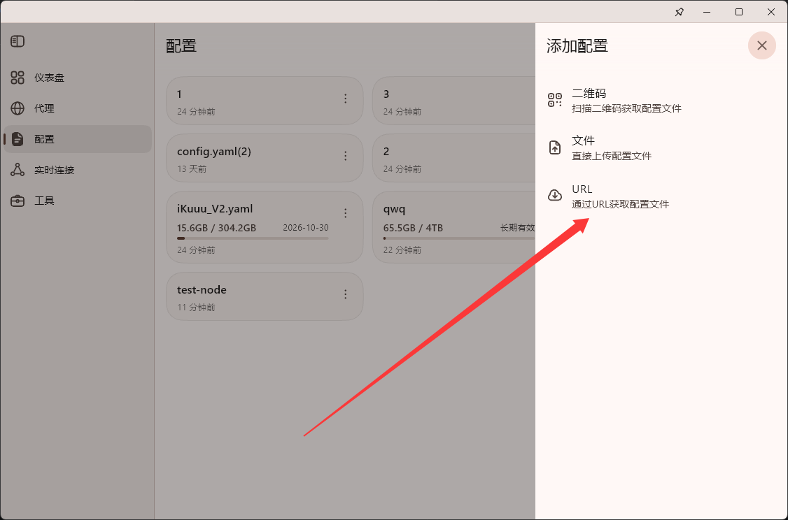
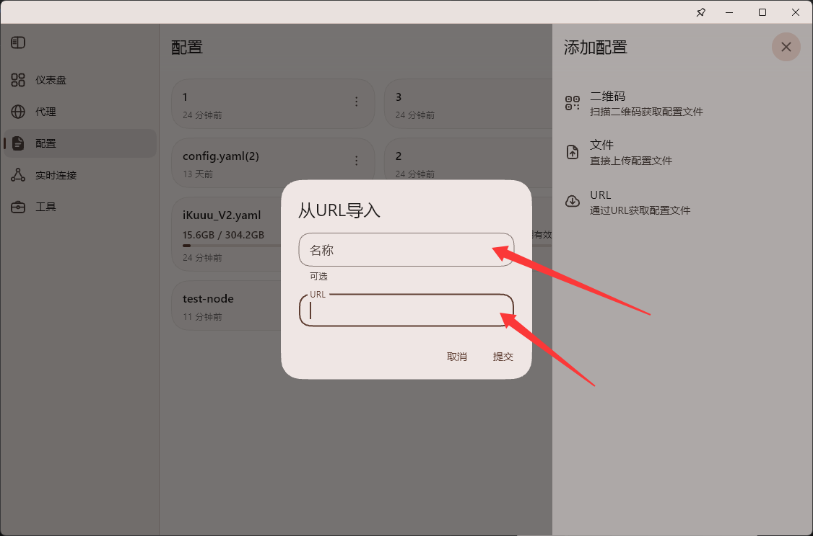
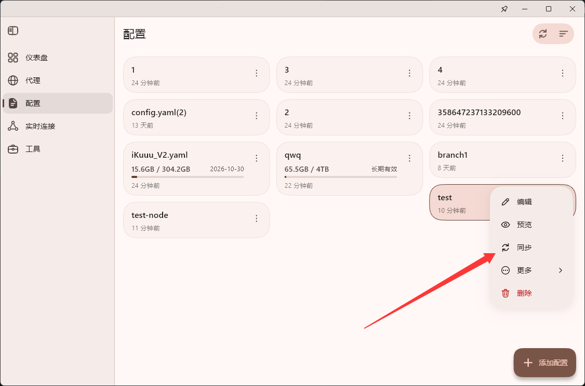
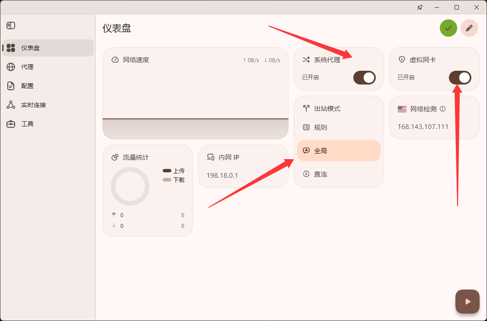

# VPN 代理节点使用规范

## 一、座位分布与节点归属

使用前请先确认所属部门及对应订阅分组。座位图、空位、特殊岗位和 **1部A / 1部B** 的人员分配已集中整理在独立页面。

**[查看座位分布与节点归属详情 →](./seat-map.md)**

## 二、各部门订阅节点分配

<SubscriptionList />

点击对应部门的地址会自动复制到剪贴板，随后可粘贴到 FlClash 的 URL 输入框。

### 特殊部门节点说明

- 人事、翻译：使用 **7部节点**
- 监察：使用 **1部B节点**
- 策划、技术：使用 **1部A节点**
- Lu、王总、旺哥：使用 **市场节点**

---

# 三、节点使用规范（请务必阅读）

## 1. 节点类型说明

每个订阅地址中包含两个代理节点：

- **日常节点（默认使用）**
- **备用节点（特殊情况下使用）**



## 2. 节点切换规则

1. 日常情况下，请始终使用 **日常节点**。

2. 当出现以下情况时，可以临时切换至备用节点：

   - 晚高峰网络明显变慢
   - 代理连接不稳定
   - 访问海外平台出现严重卡顿

3. 备用节点仅用于临时缓解网络问题，请勿长期占用。

4. 使用备用节点一段时间后，请重新测试日常节点：

   - 若日常节点恢复正常，请立即切回日常节点。
   - 避免备用节点长期承担全部访问压力。

---

# 四、FlClash 客户端使用说明 {#windows-usage}

## 1. 添加对应部门订阅地址

首先获取自己所属部门对应的订阅地址：

> 订阅地址请查看：
> [各部门订阅节点分配](#二、各部门订阅节点分配)

进入 FlClash：



选择：

```
URL
```

方式添加订阅：



填写配置名称：

请在「名称」位置填写清晰的备注名称，方便后续区分和管理。

例如：

```
市场组节点
7部节点
1部A节点
1部B节点
```

然后将对应订阅地址填写到 URL 输入框。



---

## 2. 更新订阅节点

当节点发生变化或需要刷新节点列表时：

点击：

```
同步
```

更新订阅内容。



---

## 3. FlClash 必要配置

首次添加订阅后，请确认以下配置已开启：



必须确认：

- 系统代理：开启
- 虚拟网卡：开启
- 出站模式：全局

---

# 五、FlClash 客户端下载与安装

Windows 电脑请阅读独立的 **[Windows FlClash 下载与安装教程](./client-download.md#windows)**，按说明选择 **Setup x64** 安装版。

- [Android FlClash 下载与安装](./client-download.md#android)
- [iPhone / iPad Shadowrocket 下载与安装](./client-download.md#ios)

安装客户端后，请返回本页第四部分继续配置公司订阅。
