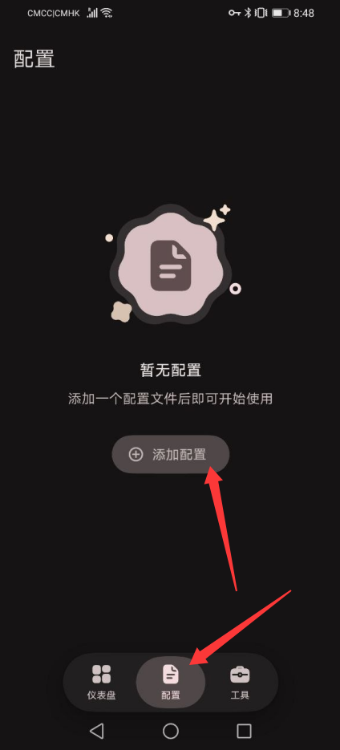
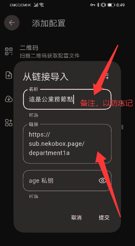
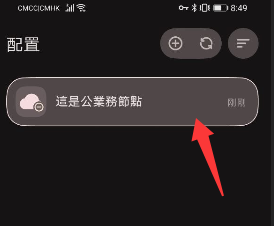
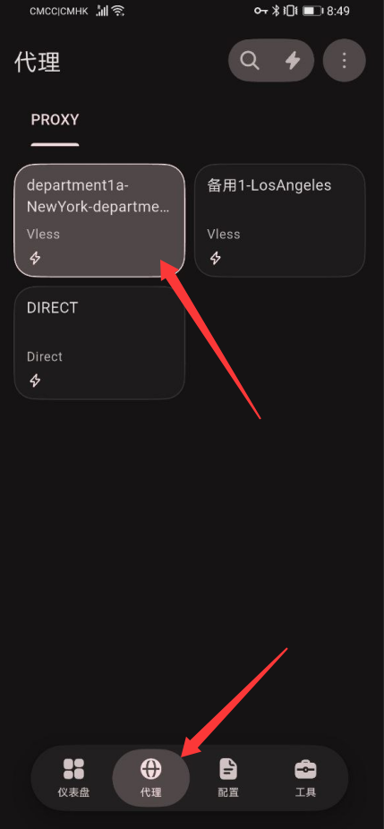
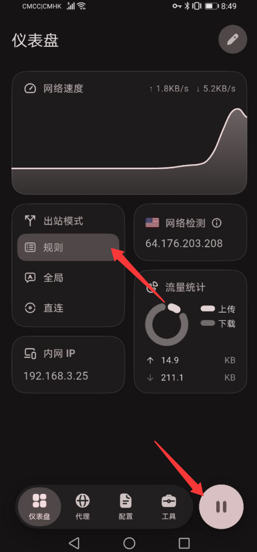

# Android 手机 VPN 使用教程（FlClash）

本教程用于指导 Android 手机通过 **FlClash** 导入公司 VPN 订阅、选择对应部门的节点并开启代理。操作界面以本页截图为准；不同版本的按钮位置可能略有区别。

::: warning 使用前请确认
- 使用 **本人所属部门**的订阅地址，不要随意使用其他部门的节点。
- 日常优先使用 **日常节点**；仅在网络异常时临时切换 **备用节点**，恢复后及时切回。
- 公司要求通过代理访问相关业务平台时，请将出站模式设为 **全局**，不要直接照搬截图中尚未切换的「规则」状态。
:::

## 一、安装 FlClash

1. 在手机上安装 FlClash。建议从[FlClash 项目发布页](https://github.com/chen08209/FlClash/releases)下载适合 Android 的安装包（通常为 `.apk`）。
2. 安装完成后打开应用。如果系统要求允许安装此来源的应用，请先确认安装包确实来自上述项目发布页。
3. 初次开启代理时，Android 可能弹出 VPN 连接授权提示，请选择 **允许**。

::: tip 找不到安装包？
请在发布页的最新版本中展开 **Assets**，选择 Android 对应的 APK 文件。不要下载 Windows、macOS 或 Linux 的安装包。
:::

## 二、获取所属部门的订阅地址

| 部门 / 节点分组 | 订阅地址 |
| --- | --- |
| 6部 | `https://sub.nekobox.page/department6` |
| 7部 | `https://sub.nekobox.page/department7` |
| 1部B | `https://sub.nekobox.page/department1b` |
| 1部A | `https://sub.nekobox.page/department1a` |
| 市场 | `https://sub.nekobox.page/department0` |

**特殊部门：** 人事、翻译使用 **7部**；监察使用 **1部B**；策划、技术使用 **1部A**；Lu、王总、旺哥使用 **市场**。

请复制表格里属于自己部门的 **完整订阅地址**。如有调整，以[VPN 代理节点使用规范](./guide.md)为准。

## 三、添加订阅配置

### 第 1 步：进入「配置」

打开 FlClash，在底部选择 **配置**。如果首次打开还没有任何配置，点击中间的 **添加配置**。

### 第 2 步：通过链接导入

在添加配置的页面选择 **从链接导入**，填写以下内容：

- **名称**：填写方便识别的备注，例如 `6部节点`、`7部节点`、`市场组节点`。
- **链接**：粘贴第二部分中对应部门的完整订阅地址。
- **私钥**：没有特别通知时，保持默认即可。

确认地址无误后，点击 **提交**。

::: warning 注意
图片中的部门地址仅为操作示例，实际操作请使用 **自己部门**的订阅链接。
:::

### 第 3 步：确认配置已导入

返回 **配置** 页面，确认刚才命名的订阅配置已出现在列表中，并处于已选用状态。若列表未更新，可尝试使用该页面的刷新功能。

## 四、选择日常节点

点击底部 **代理**，进入节点列表。在 **PROXY** 分组中选择对应部门的 **日常节点**。

- 名称包含部门标识的正常节点：日常优先使用。
- 名称含 **备用** 的节点：仅当日常节点不可用或明显卡顿时临时使用。
- **DIRECT**：表示直连，不是公司的代理节点，不要将其当作日常 VPN 节点。

点击节点卡片后，确认所选节点的高亮状态。

## 五、设置全局代理并连接

1. 点击底部 **仪表盘**。
2. 点击 **出站模式**，按公司使用规范选择 **全局**。
3. 点击右下角的 **启动按钮**，开启代理；如果弹出系统 VPN 授权提示，请允许。
4. 开启后检查状态和网络速度区域是否开始显示活动信息，再打开需要使用的海外平台测试连接。

::: info 截图状态说明
截图里的「规则」仅是截图时选中的模式，**请主动切换为「全局」**。右下角按钮如果显示暂停图标，通常代表代理已经开启，点击它会停止代理；不要误以为还需要再点击一次。
:::

## 六、日常使用与节点更新

- **正常使用**：启动 FlClash → 确认选中对应订阅 → 在「代理」页使用日常节点 → 仪表盘开启代理。
- **暂时卡顿**：切换备用节点测试；恢复正常后切回日常节点。
- **节点发生变化**：到「配置」页刷新或更新原有订阅，**不要反复导入相同 URL**。
- **不用代理时**：通过仪表盘停止连接。

## 七、常见问题

| 问题 | 处理方法 |
| --- | --- |
| 提交订阅后没有节点 | 检查订阅地址是否完整、部门是否正确，并尝试更新订阅；确认手机网络能访问订阅地址。 |
| 点击启动后无法连接 | 确认已允许 Android 的 VPN 授权；检查手机是否有可用网络，随后重新开启。 |
| 节点显示但业务平台打不开 | 确认已选择日常节点，且 **出站模式为全局**；必要时临时测试备用节点。 |
| 订阅更新失败 | 先排除手机网络问题，再检查订阅地址是否被误改；仍失败请联系技术人员。 |
| 节点很慢 | 先切换手机网络或刷新订阅；必要时暂用备用节点，日常恢复后切回。 |

**相关文档：** [VPN 代理节点使用规范](./guide.md) · [iPhone / iPad 使用教程](./mobile-ios.md)
