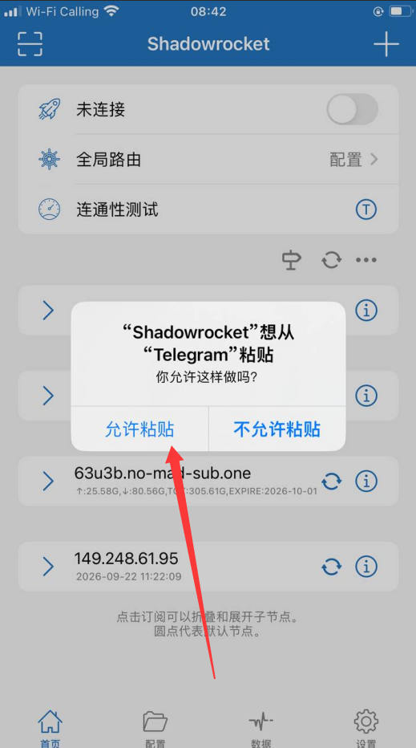
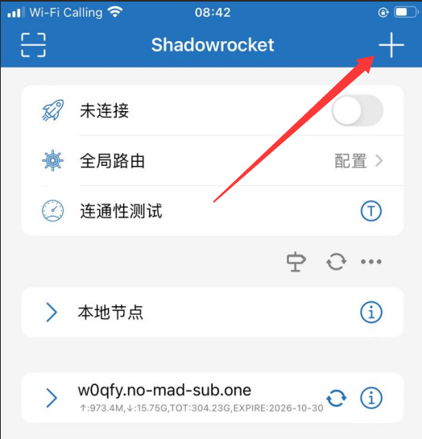
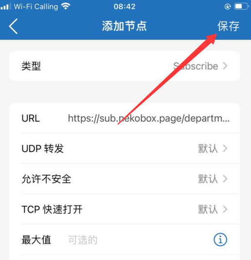
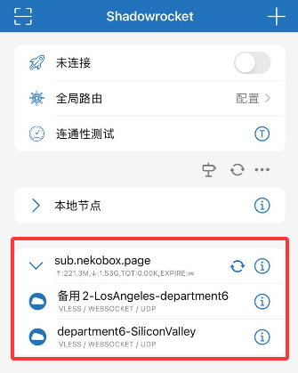
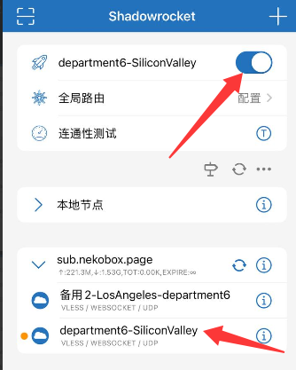

# iPhone / iPad VPN 使用教程（Shadowrocket）

本教程介绍如何在 iOS / iPadOS 上使用 **Shadowrocket（小火箭）** 添加公司 VPN 订阅、选择日常节点并开启代理。以下截图来自 iPhone，iPad 的界面布局可能有所不同。

::: warning 使用前请确认
- 订阅地址要与 **本人所属部门**一致。
- 优先使用 **日常节点**；备用节点只供网络异常时临时使用。
- 访问需通过公司代理的业务平台时，将 **全局路由**设置为 **代理**。图片中的「配置」是截图时的状态，不代表必须保持该状态。
:::

## 一、下载安装客户端

使用 iPhone 或 iPad 的用户，请先阅读 **[Shadowrocket 客户端下载与安装教程](./client-download.md#ios)**，通过 Apple App Store 下载并安装。

安装成功后，返回本页继续导入公司订阅。

## 二、获取所属部门订阅地址

| 部门 / 节点分组 | 订阅地址 |
| --- | --- |
| 6部 | `https://sub.nekobox.page/department6` |
| 7部 | `https://sub.nekobox.page/department7` |
| 1部B | `https://sub.nekobox.page/department1b` |
| 1部A | `https://sub.nekobox.page/department1a` |
| 市场 | `https://sub.nekobox.page/department0` |

**特殊部门：** 人事、翻译使用 **7部**；监察使用 **1部B**；策划、技术使用 **1部A**；Lu、王总、旺哥使用 **市场**。

复制对应部门的完整链接，后面会粘贴到 URL 栏。更多要求参见[VPN 代理节点使用规范](./guide.md)。

## 三、添加订阅

### 允许粘贴订阅地址

建议先复制所属部门的订阅地址。如果 Shadowrocket 提示 **「允许粘贴」**，请点击 **允许粘贴**，方便将链接填入订阅 URL；也可以手动输入。

### 第 1 步：点击右上角「+」

在 Shadowrocket 的 **首页** 点击右上角的 **+**，打开「添加节点」页面。

### 第 2 步：选择订阅类型并填写 URL

1. 点击 **类型**，选择 **Subscribe（订阅）**。
2. 在 **URL** 一栏粘贴自己部门的订阅地址。
3. 其他选项没有特别要求时保持默认，然后点击右上角 **保存**。

::: warning 注意
示例图片里的地址只是操作演示。请按实际部门使用对应订阅地址，不要复制截图里显示的示例链接。
:::

### 第 3 步：确认订阅和节点已出现

保存后回到首页。展开新添加的订阅分组（例如 `sub.nekobox.page`），确认其中列出了可用节点。

图中同时展示了 **备用节点** 和 **日常节点**。如果分组没有展开，点击分组左侧的箭头查看节点。

## 四、选择日常节点并开启代理

1. 在订阅分组中点击 **日常节点**。通常为带有本人部门标识且 **不含「备用」** 字样的节点。
2. 点击首页 **全局路由**右侧的 **配置**，将路由模式改为 **代理**（如公司要求全部业务流量走代理）。
3. 打开页面顶部右侧的 **连接开关**。
4. 首次连接时，iOS 可能提示添加 VPN 配置。选择 **允许**，并按系统要求完成设备密码或 Face ID / Touch ID 验证。
5. 开关开启并出现 VPN 连接状态后，打开需要使用的平台确认访问正常。

::: info 截图状态说明
图片中「全局路由」一栏显示为「配置」，那是截图时的路由模式；若按本教程使用公司要求的全局代理，请主动修改为 **代理**。开关显示为蓝色一般表示已打开。
:::

## 五、订阅更新与备用节点使用

- **订阅更新**：在首页找到订阅分组，点击分组旁的 **刷新图标**，重新获取最新节点列表。
- **临时切换备用节点**：日常节点异常时点击名称包含 **备用** 的节点，测试网络；日常节点恢复后及时切回。
- **关闭代理**：无需使用时，将首页顶部的连接开关关闭即可。
- **节点有变动**：优先更新现有订阅，无需重新创建相同订阅。

## 六、常见问题

| 问题 | 处理方法 |
| --- | --- |
| 粘贴 URL 时无内容 | 检查是否复制了完整链接；在系统提示出现时允许粘贴，或手动输入。 |
| 保存后没有出现节点 | 确认添加类型为 **Subscribe**、URL 正确，尝试使用订阅旁的刷新按钮。 |
| 无法开启 VPN | 确认已允许添加 VPN 配置，并检查系统设置中的 VPN 授权状态。 |
| 显示连接但平台仍无法访问 | 检查所选节点和全局路由设置，并测试日常节点或临时切换备用节点。 |
| 提示订阅更新失败 | 检查手机网络、URL 拼写与订阅是否有效；持续失败请联系技术人员。 |

**相关文档：** [客户端下载与安装](./client-download.md#ios) · [VPN 代理节点使用规范](./guide.md) · [Android 使用教程](./mobile-android.md)
